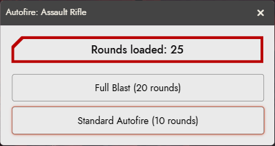
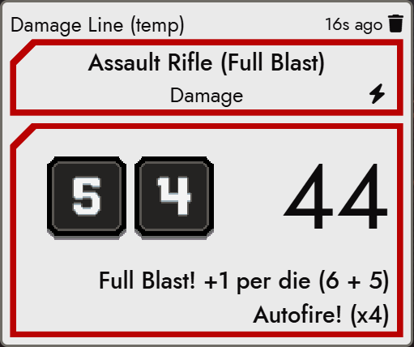

# Autofire Homebrew for Cyberpunk RED

Homebrew Autofire rules for Cyberpunk RED in Foundry VTT v12. The first rule is Full Blast: spend double ammunition on an Autofire attack for more damage.

## Credit

Full Blast is the Adjustable Gas Piston by u/Infernox-Ratchet, from _Heavy Armor Lizard's Autofire Compendium_ ([reddit post](https://www.reddit.com/r/cyberpunkred/comments/1wspvae/heavy_armor_lizards_autofire_homebrew_compendium/), [Google Doc](https://docs.google.com/document/d/10Urp21DHQ6FP0OGr-oKwqXbIZsYK95-Hsev5wgLy420/edit?usp=sharing)). The compendium also thanks Fershte and Corgopolis for some of its items. This module describes the rule in its own words.

## Full Blast

When you attack with Autofire, a prompt asks whether to Full Blast. Every Autofire weapon gets the prompt, unless the GM requires the Adjustable Gas Piston (see Settings).

- **Standard Autofire** (default): the rules as written, 10 rounds.
- **Full Blast**: spends twice the Autofire cost (20 rounds), hit or miss. It is unavailable when fewer rounds are loaded.

Full Blast damage adds 1 to each of the 2d6 before the Autofire multiplier. A die cannot be raised above 6, so a natural 6 stays 6: the total is (d1 + d2 + 2) x multiplier + other modifiers, less 1 x multiplier for each natural 6. The damage card shows a line such as "Full Blast! +1 per die (6 + 5)" above the Autofire multiplier, and lists the bonus as a "Full Blast (+1 per die)" modifier in the breakdown. Die images keep the natural rolls. Critical injuries need two natural 6s, and the +5 critical bonus is unchanged.

The damage dialog has a "Full Blast?" checkbox for Autofire damage (see Settings for when the GM requires the Adjustable Gas Piston). It is pre-checked when you roll from a Full Blast attack card.

## Settings

Three world settings, all off by default and independent:

- **Allow dice results to be modified above 6**: a natural 6 becomes 7, so the total is always (d1 + d2 + 2) x multiplier + other modifiers.
- **Count modified dice towards criticals**: a die Full Blast raises to 6 or more counts toward the critical, as a natural 6 does. A natural 5 then counts, and so does a natural 6 raised to 7. Natural 6s always count.
- **Require the Adjustable Gas Piston for Full Blast**: only a weapon with the Adjustable Gas Piston installed gets the prompt. Other Autofire weapons fire standard Autofire, and their damage dialog has no "Full Blast?" checkbox unless the roll started as Full Blast. The piston is in the **Autofire Homebrew Items** compendium; install it in a weapon like any upgrade. It takes no slot. Full Blast cards made before the setting was turned on still roll Full Blast damage.

With Pneuma's Combat Tools, the second setting changes CPR's damage card (the +5 and "Critical Damage") but not Pneuma's critical injury button, which counts natural 6s only.

## Differences from the source

- By default, Full Blast works with every Autofire weapon. The source makes it an invented tech upgrade (Upgrade DV24, 1,000eb) installed on one weapon. **Require the Adjustable Gas Piston for Full Blast** (off by default) enforces the upgrade, but not its DV or cost.
- The source's alternate rule (roll 3d6 and drop the lowest) is not implemented.
- **Allow dice results to be modified above 6** (off by default) departs from the source, which caps a raised die at 6.
- **Count modified dice towards criticals** (off by default) goes beyond the source, which says nothing about critical injuries. With it off, the core rule applies: two natural 6s.

## Pneuma's Combat Tools

Verified with Pneuma's Combat Tools 0.9.16. It is optional; nothing changes when it is not active.

- Autofire attacks from Pneuma's token HUD, and sheet attacks Pneuma routes through its exchange, show the Full Blast prompt (subject to the Gas Piston setting) and spend the Full Blast cost.
- Pneuma's damage button on a Full Blast attack rolls Full Blast damage. A click rolls at once; Shift-click opens CPR's damage dialog, which shows "Full Blast?" checked. (Before Pneuma 0.9.15 the two were the other way round.)
- Pneuma's attack cards show "(Full Blast)".
- Pneuma's HUD still disables Autofire below 10 rounds. The prompt disables Full Blast below 20.
- With another Pneuma version, the GM sees one warning. If its damage button stops rolling Full Blast damage, open CPR's damage dialog from it and tick "Full Blast?".

## Requirements

- Foundry VTT v12 (verified 12.343)
- Cyberpunk RED Core (verified 0.92.4)
- libWrapper

## Install

- **Manifest URL**: in Foundry Setup, open Add-on Modules, choose Install Module, paste `https://github.com/TheCadoc/cpr-autofire-homebrew/releases/latest/download/module.json` into Manifest URL, and install.
- **By hand**: download `module.zip` from the [latest release](https://github.com/TheCadoc/cpr-autofire-homebrew/releases/latest) and extract it into `Data/modules/cpr-autofire-homebrew`, so that `module.json` sits directly in that folder. Then return to Setup, or restart Foundry.

Enable libWrapper and this module in your Cyberpunk RED world.

## Contributing

See [CONTRIBUTING.md](CONTRIBUTING.md).

## License

The code is licensed under the MIT License (see [LICENSE](LICENSE)). The Full Blast rule belongs to its author, credited above.

## Disclaimer

Autofire Homebrew for Cyberpunk RED is unofficial content provided under the Homebrew Content Policy of R. Talsorian Games and is not approved or endorsed by RTG.
